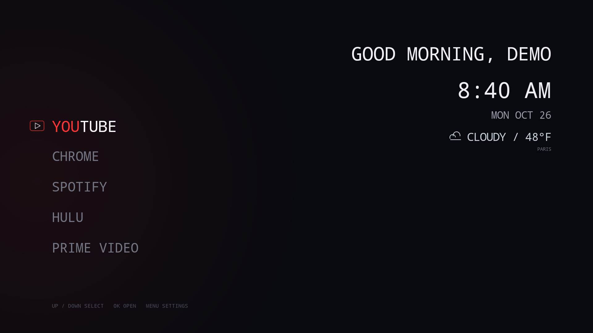
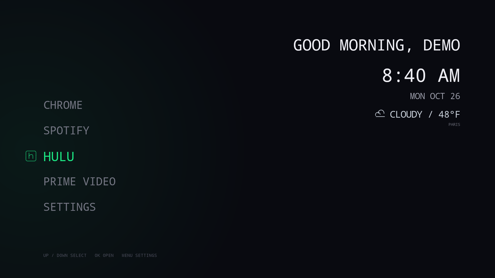
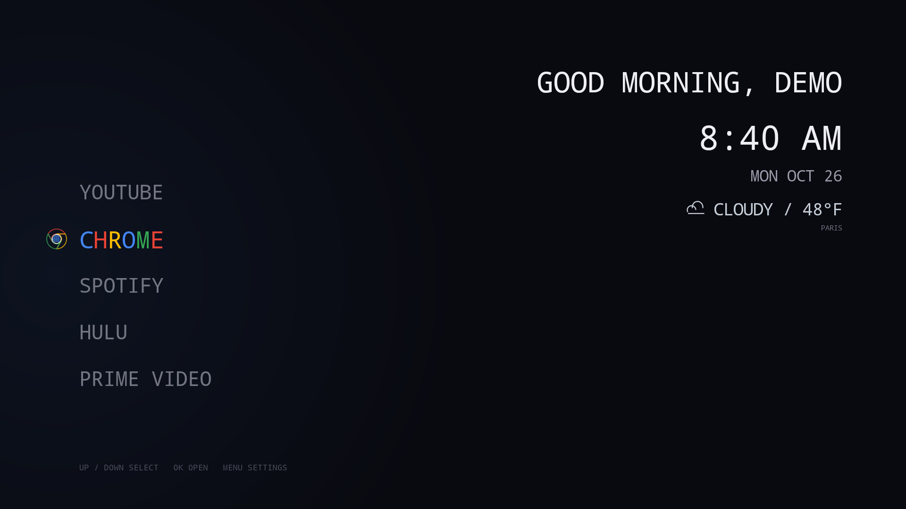
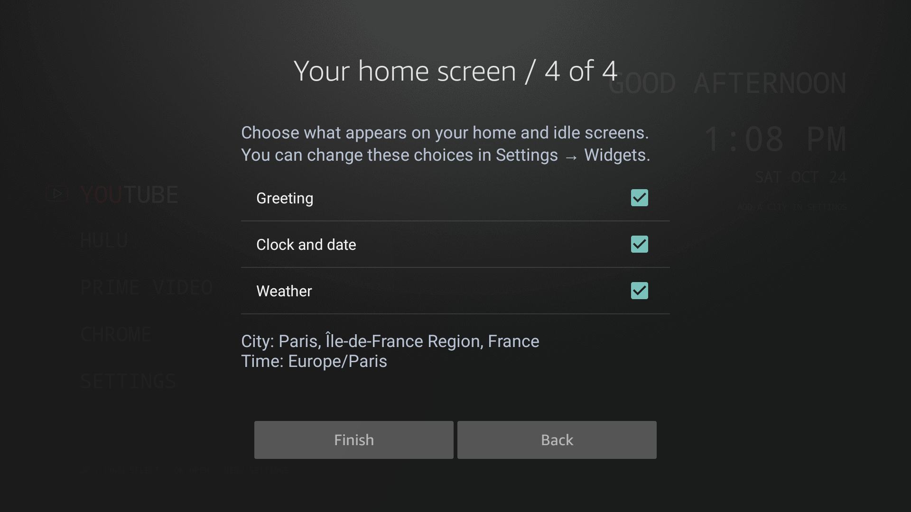
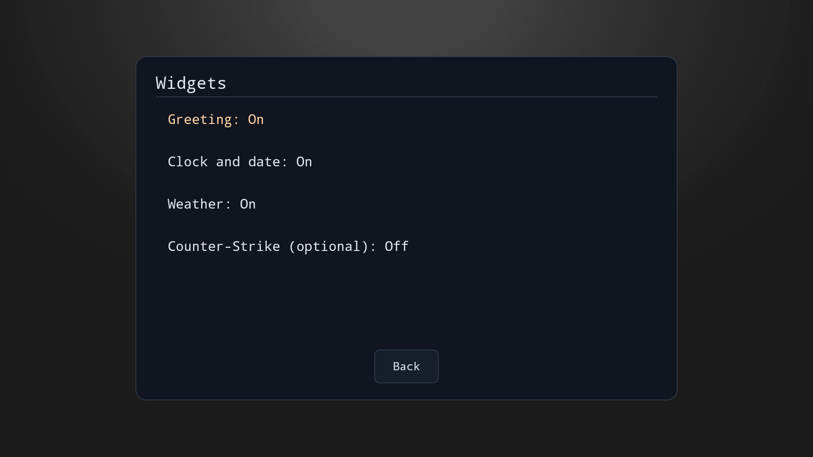
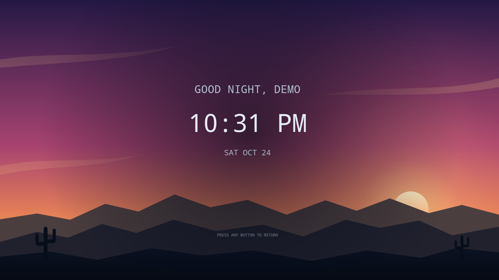
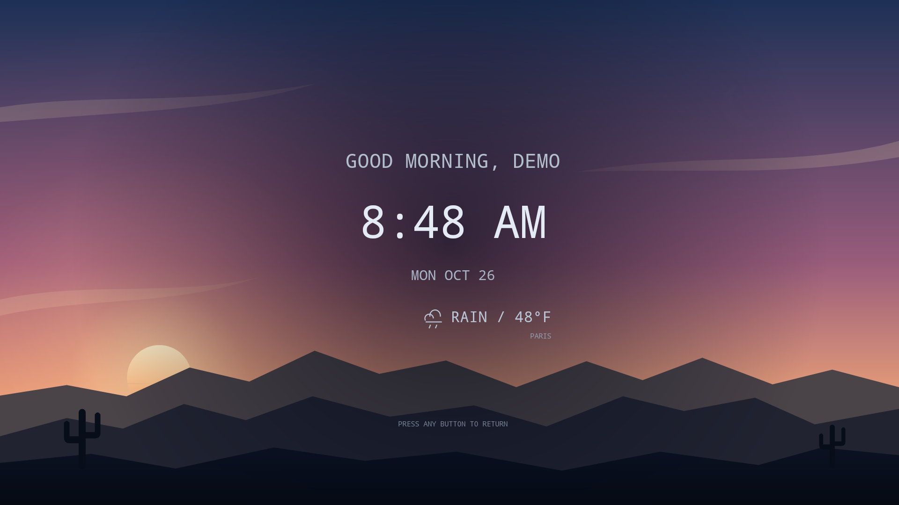
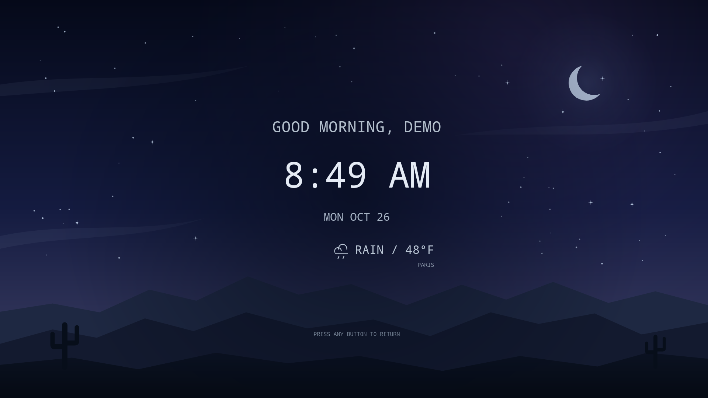
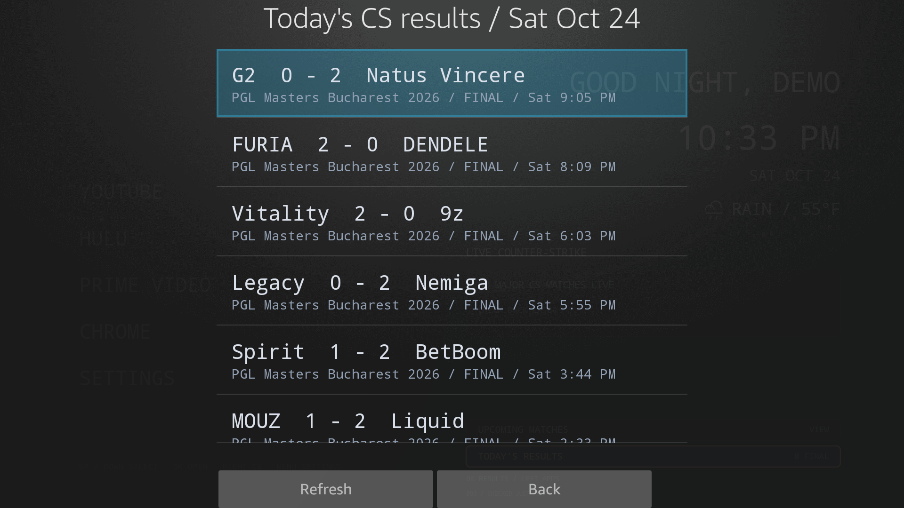

# Quiet TV

**A calmer home screen. A more personal TV.**

Quiet TV is a lightweight, customizable Fire TV launcher built to clear away the clutter of a traditional smart TV home screen. Designed with lower-powered TVs in mind, it keeps navigation simple and the interface lean, putting your chosen apps and information front and center—without rows of ads, promotions, unwanted app shortcuts, and recommendation feeds competing for your attention.



*Your apps on the left. Useful information on the right. No promotional feed.*

The goal is simple: turn on your TV and get straight to what you want. Your apps, clock, weather, and ambient visuals come together in a clean, remote-friendly menu. Choose which apps appear, arrange them your way, and give your TV a look that feels like yours.

App-inspired colors and logos respond as you browse, while an idle display shifts through sunrise, daylight, sunset, and night. Appearance controls, optional smart lighting, and a warm evening screen filter let you adjust the atmosphere without filling the menu with distractions.

## What it does

- **A short first-time setup.** Add a greeting name, optionally find your city, choose installed apps, and pick greeting, clock/date, and weather widgets. You can skip the city and finish offline.
- **Widget controls.** Show or hide greeting, clock/date, and weather on the home and idle screens. Optional extras are enabled separately in Settings → Widgets.
- **Your apps, your order.** Show the installed apps you use, rearrange their order, and launch them with the remote.
- **Responsive app themes.** Supported apps display their own colors and dotted brand-inspired logos when highlighted.
- **Personal appearance.** Customize the greeting, choose a clean terminal or dot-matrix type style, and adjust the menu's appearance.
- **Clock, weather, and an ambient idle display.** Keep useful information visible against a desert sky that follows seasonal sunrise, sunset, and the time of day.
- **Optional smart lighting.** Match compatible Govee lights to the selected app, choose color palettes, or switch between controller-run effects. The current integration targets the H6097.
- **A warmer evening screen.** Enable a warm, dim overlay and choose from three strengths.
- **Home and app-return helper.** On the tested Fire OS version, an optional local helper returns to Quiet TV on Home, app exit, boot, and wake.

No advertising feed, bundled streaming content, web UI framework, or separate discovery server. Streaming apps are installed separately and may require their own accounts.

## App themes that respond as you browse

Each supported app has its own color, lettering treatment, and dotted brand-inspired mark. The background glow follows your selection.

| Hulu | Browser shortcut |
| --- | --- |
|  |  |

## Set it up once, adjust it whenever you like

| First-time setup | Widget controls |
| --- | --- |
|  |  |

Choices are saved when you finish setup. Settings includes **City and time** and **Run setup again**; rerunning setup begins with your existing choices. No account or device-location permission is needed for city search. Without a selected city, the clock follows the TV's timezone and the sky uses preset transitions. [Setup behavior and preview testing](docs/PUBLIC-SETUP.md).

The Chrome-inspired shortcut opens **Amazon Silk**. It changes the label and visual theme; it does not install Chrome.

## An idle screen with a sense of time



*Sunset brings warm color to the horizon. Daily seasonal sun times guide the scene's transitions.*

| Sunrise | Night |
| --- | --- |
|  |  |

These are captures from the TV. Sunrise and sunset use the app's built-in sky previews; the clock continues to show the actual time. The scene is drawn locally rather than playing a background video.

## Optional Counter-Strike widget

Counter-Strike is **off by default and absent from first-time setup**. Enable it later in **Settings → Widgets → Counter-Strike (optional)**. Its feed is not created or polled while disabled. When enabled, compact cards show notable live matches, series scores, and a route to the verified organizer broadcast. Upcoming Matches browses today and the following six days in local time. Use Left/Right to change the day, Up/Down to scroll matches, and Menu to refresh. The home-screen NEXT TODAY suggestion stays limited to today. Today's results keeps completed matches visible until local midnight, including eligible matches missed while the TV was off.

<details>
<summary>See the optional match-results view</summary>



</details>

Only a source-confirmed live match receives a LIVE badge. Live data expires after three minutes without a successful refresh. Stream selection prefers an organizer identity associated with that specific match; if it cannot verify one, the UI offers an explicitly labeled match-page fallback.

Direct HLTV access returned HTTP 403 during development. Discovery therefore uses BO3's publicly reachable, **undocumented website interface**, which may change. Organizer profiles currently cover PGL, ESL/IEM, and BLAST. See [data sources and behavior](docs/DATA-SOURCES.md).

## Built for a modest TV

Native Java and Android Canvas, with cached drawing assets, bounded image caches, asynchronous network work, and visibility-aware refreshes. The idle sky is procedural and updates with the launcher clock; it is not a continuously running video or animation.

Tested on an **Insignia NS-50F301NA24**, Android 9 / Fire OS 7, with 2 GB RAM. Other TV models and newer Fire OS versions have not been verified. Optional Home routing depends on device-specific system behavior.

## Try the source

This is a development snapshot, not a universal Fire TV installer. There is no prebuilt APK in this repository. Start with [building and setup](docs/BUILDING.md), then review [permissions and privacy](docs/PRIVACY.md).

This snapshot prepares a future shared version. First-time setup saves your greeting and app choices; city search configures weather and seasonal sun times without source edits. Choose the city's timezone or the TV's timezone. The optional CS schedule and results use the selected local day, including daylight-saving boundaries. The Home/app-return helper starts off and requires separate setup if enabled. All screenshots use a demo profile and an example city. No personal TV profile is included.

| Remote control | Action |
| --- | --- |
| Up / Down | Select an app or CS card |
| OK | Open the selected item |
| Right / Left | Enter / leave the optional CS section when enabled |
| Menu | Settings or selected match options |
| Back | Return through settings or close a detail view |

## Project map

```text
app/AndroidManifest.xml       Android entry points and permissions
app/src/com/quiettv/home/     Launcher, sky, lights, night overlay, and CS logic
app/res/raw/cs_policy.json   Configurable tournament filtering
app/res/raw/cs_broadcasters.json  Reviewed organizer identities
scripts/build.ps1            Local Windows build using your Android SDK and JDK
docs/                       Setup, data sources, privacy, and screenshots
```

The on-device CS implementation passed 130 Android-runtime checks covering live status, filtering, broadcaster selection, upcoming schedules, result dates, final scores, caches, and bounded retention. Remote navigation, Twitch playback, schedule/result details, nested Back behavior, and font switching were also checked on the TV. [Validation notes](docs/VALIDATION.md) distinguish device checks from logic checks and remaining limitations.

## Credits and rights

Built with Codex. Weather and sunrise/sunset data are provided by [Open-Meteo](https://open-meteo.com/), with attribution under [CC BY 4.0](https://creativecommons.org/licenses/by/4.0/). Match information and team/event images come from BO3. Third-party names, marks, data, and images belong to their respective owners; this project is not affiliated with those brands or services.

An open-source license has not been selected. Publishing the source for viewing does not itself grant a general license to reuse it.
